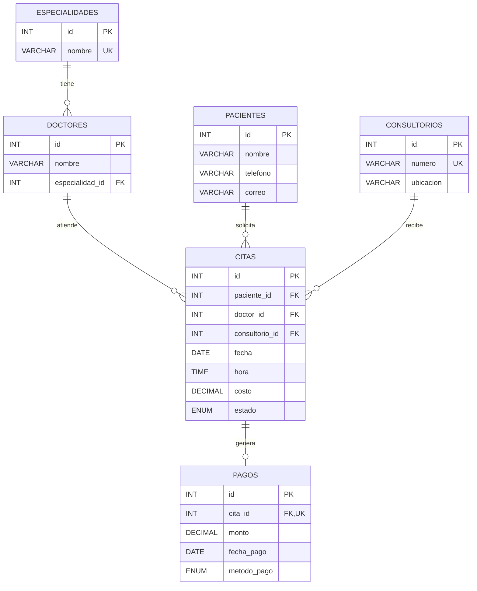

# Diagrama entidad-relación — Sistema de clínica

El diagrama incluye las seis tablas, claves primarias (PK), claves foráneas (FK) y cardinalidades.

**Cardinalidades:** cada doctor pertenece a una especialidad; cada cita pertenece a un paciente, un doctor y un consultorio; cada cita tiene de cero a un pago completo.

**Reglas simplificadas:** un pago completo por cita, y horarios de una hora que se comparan por fecha y hora de inicio.
